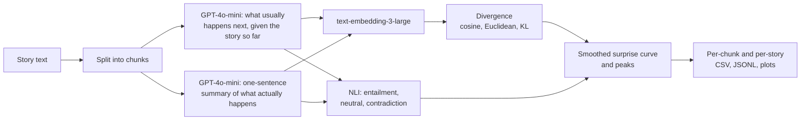

<div align="center">

# Quantifying Narrative Surprise

**Find the plot twists in a story by measuring how far what actually happens drifts from what a language model expected to happen next.**

[How it works](#how-it-works) &nbsp;·&nbsp; [Data](#data) &nbsp;·&nbsp; [Run it](#run-it)


</div>

## How it works, in one page

- **The problem:** plot twists drive engagement in fiction, but most computational methods find them with hand-coded features or after-the-fact annotation, not by modelling what a reader expects as the story unfolds.
- **The idea:** treat surprise as **sequential anomaly detection**. At each point in a story, ask a language model what would usually happen next, summarize what actually happens, and measure the gap. Large gaps are candidate twists.
- **What's measured:** semantic distance between the expected and actual events (cosine, Euclidean and KL divergence on embeddings), and whether they logically contradict each other (natural language inference), then smoothed peaks over the story.

> [!NOTE]
> **A University of Michigan NLP project** by Devashish Juyal and Yuganshi Agrawal. The notebooks are the working record; the analysis outputs in `outputs/` cover a baseline fable and sample stories, not the full corpus.

---

## How it works



1. **Chunk** each story in order.
2. **Expect vs. observe:** for each chunk, GPT-4o-mini writes a "business as usual" prediction from the context so far, and a present-tense summary of what actually happens.
3. **Measure:** both sentences are embedded with `text-embedding-3-large` and compared by cosine distance, Euclidean distance and KL divergence; an NLI model labels the pair as entailment, neutral or contradiction.
4. **Find the twists:** the per-chunk scores are smoothed and their peaks flagged, then summarized per story.

## Data

- **Thriller short stories** scraped from [Reedsy Prompts](https://blog.reedsy.com/short-stories/thriller/) and [Short Fiction Break](https://shortfictionbreak.com/category/genre/thrillersuspense/): 184 text files in `StoryScraper/stories/`.
- **Classic novels** by chapter (for example *Frankenstein*, *Vanity Fair*), 12 books in `TedUnderwoodImplementation/chapterbooks/`, used to reproduce Ted Underwood's twist-prediction setup.
- **A baseline**: a predictable fable, to check that the surprise curve stays flat when nothing surprising happens.

## The notebooks

| Notebook | What it does |
|---|---|
| `AdvancedSurpriseAnalyzer.ipynb` | The full pipeline: predictions and summaries, embeddings, three divergence metrics, plots, and CSV/JSONL/Parquet export |
| `Parser.ipynb` | The earlier pipeline with RoBERTa-MNLI contradiction scoring and per-story summaries |
| `StoryScraper/storytotext.ipynb` | Scrapes and cleans the story corpus |
| `TedUnderwoodImplementation/Pass.ipynb` | Reproduces the Underwood (2024) approach on classic novels |

## Run it

**Prerequisites:** Python 3, Jupyter, and an OpenAI API key (every chunk costs a few model and embedding calls).

```bash
git clone https://github.com/juyal-devashish/QuantifyingNarrativeSurprise.git && cd QuantifyingNarrativeSurprise
python -m venv .venv && source .venv/bin/activate
pip install openai python-dotenv pandas numpy scipy matplotlib seaborn nltk transformers torch jupyter
echo "OPENAI_API_KEY=sk-..." > .env
jupyter lab AdvancedSurpriseAnalyzer.ipynb
```

## Repository layout

```
AdvancedSurpriseAnalyzer.ipynb   the main pipeline
Parser.ipynb                     the earlier pipeline with NLI scoring
StoryScraper/                    corpus scraper, the 184 stories, sample per-chunk outputs
TedUnderwoodImplementation/      Underwood reproduction and 12 chaptered novels
outputs/                         per-chunk and per-story analysis CSVs
NLP Project Proposal (1).pdf     the original proposal
```

## References

- Levy, R. (2008). *Expectation-based syntactic comprehension.* Cognition.
- Piper, A., Xu, H., and Kolaczyk, E. (2023). *Modeling narrative revelation.* CHR 2023.
- Wilmot, D., and Keller, F. (2020). *Modeling suspense in short stories.* ACL.
- Underwood, T. (2024). *Can language models predict the next twist in a story?*
